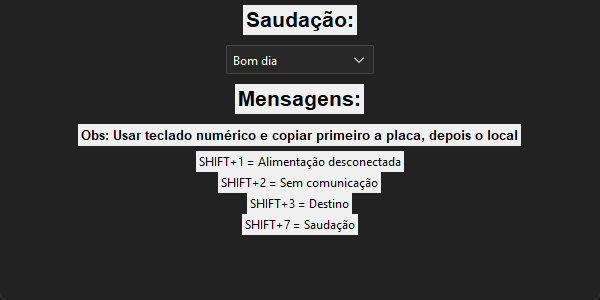

# SigaText — Macro de mensagens

> Aplicativo de Windows que digita mensagens prontas de atendimento a partir do que foi copiado, usando atalhos de teclado.

**EN:** Small Windows desktop tool (Python + Tkinter) that watches the clipboard and, on a keyboard
shortcut, types a ready-made support message filled with the last two copied values (vehicle plate
and location). Built to speed up repetitive customer messages.



## Sobre

Projeto pessoal, feito para agilizar o atendimento de alertas de rastreamento veicular. O atendente
recebia alertas como "alimentação desconectada" ou "perda de sinal" e precisava escrever a mesma
mensagem para o cliente várias vezes por dia, trocando só a placa e o local.

Com o SigaText, basta copiar a **placa** e depois o **local** (Ctrl+C) e apertar um atalho. O app
monta a mensagem com a saudação escolhida e a digita no campo onde o cursor estiver.

## Funcionalidades

- Monitora a área de transferência a cada 0,5 s e guarda os **dois últimos** textos copiados.
- Saudação configurável: "Bom dia", "Boa tarde" ou "Boa noite".
- Atalhos globais (funcionam com qualquer janela em foco):

| Atalho | Mensagem digitada |
| --- | --- |
| `Shift+1` | `<saudação>! <placa> Alimentação desconectada em <local>` + "Tudo certo por aí?" |
| `Shift+2` | `<saudação>! <placa> Perda de sinal em <local>` + "Tudo certo por aí?" |
| `Shift+3` | `<saudação>! <placa> Tudo certo por aí?` |
| `Shift+7` | `<saudação>! Como podemos ajudar?` |

Os atalhos usam o `1`, `2`, `3` e `7` do teclado numérico, como indica a própria janela.
Depois de digitar, o app limpa a área de transferência.

## Tecnologias

- Python 3
- [ttkbootstrap](https://ttkbootstrap.readthedocs.io/) (Tkinter com tema escuro `darkly`)
- [pyperclip](https://pypi.org/project/pyperclip/) para ler e escrever na área de transferência
- [keyboard](https://pypi.org/project/keyboard/) para os atalhos globais e para digitar o texto
- PyInstaller e Inno Setup para gerar o executável e o instalador

## Estrutura

```
main.py               # interface, monitor da área de transferência e atalhos
main.spec             # configuração do PyInstaller
gerainstalador.iss    # script do Inno Setup que gera o instalador
icone.ico             # ícone da janela
requirements.txt      # dependências
docs/screenshots/     # imagens do README
```

## Como usar

### Pelo instalador

Baixe o instalador na página de [Releases](https://github.com/thiagaodt/siga-text/releases) e siga as
instruções. O app é instalado em `Arquivos de Programas\SigaText` e ganha um atalho no menu Iniciar.

### Pelo código

Pré-requisito: Python 3 no Windows.

```bash
py -m venv .venv
.venv\Scripts\activate
pip install -r requirements.txt
python main.py
```

> A biblioteca `keyboard` registra atalhos globais. Em algumas máquinas, ela precisa que o terminal
> seja aberto como administrador.

## Como gerar o executável

```bash
pip install pyinstaller
python -m PyInstaller --noconsole --onefile main.py
```

O executável sai em `dist\main.exe`. Para gerar o instalador, abra o `gerainstalador.iss` no
[Inno Setup](https://jrsoftware.org/isinfo.php) e compile. O arquivo final fica em `Instaladores\instalador.exe`.

## Testes

O projeto não tem testes automatizados.

## O que aprendi

<!-- TODO: pedir ao Thiago de 3 a 5 aprendizados técnicos deste projeto -->

## Licença

Distribuído sob a licença MIT. Veja o arquivo [LICENSE](LICENSE).

## Autor

Thiago Enrico Costa Cardoso — [LinkedIn](https://www.linkedin.com/in/thiago-enrico-costa-cardoso/) · [Portfólio](https://teccdev.com.br/)
